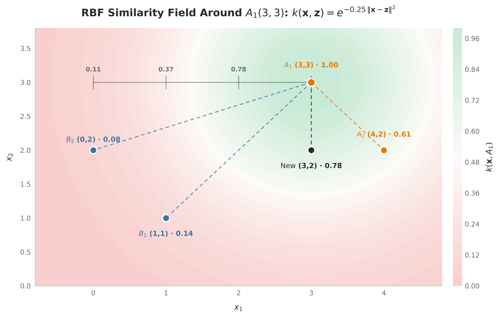
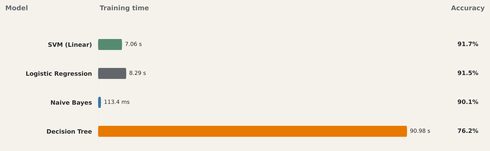

  

    <h1>Support Vector Machiness</h1>
    
Jaouhari Rayane

  

---
layout: text
---

::title::

# Roadmap

::default::

A support vector machine (SVM) is a powerful, versatile model for classification, regression, and outlier detection.

Our goal is to classify points into two classes using the best possible dividing boundary.

We build SVMs in a few steps:

1. A line that separates the classes, and determining the best such line (the margin)
2. What to do when the data can't be separated by a straight line (kernels)
3. How to do it without too many computations (the kernel trick)
<!-- 4. How SVMs compare with other methods -->

---
layout: media-text
---

::title::

# The Separator

::default::

With two features, the separator is a line, in 3D it's a plane, and with more dimensions it's a **hyperplane**.

We determine the equation of the line or separator during training based on the datapoints.
It can be written as:

$$\textcolor{#bfdbfe}{w_1} * x_1 + \textcolor{#bfdbfe}{w_2} * x_2 ... + \textcolor{#bffec6}{b} = 0$$
Or: 
$$\textcolor{#bfdbfe}{w}^\top x + \textcolor{#bffec6}{b} = 0$$

Where:
- $x$ is a data point with its full list of feaure values
- $\textcolor{#bfdbfe}{w}$ is a list of weights that sets the line's direction
- $\textcolor{#bffec6}{b}$ is an offset that shifts the line

Points are classified based on which side of the line they fall.

::media::

<!-- **[FIGURE: two clean clusters, one simple line with no margins, its equation written on the graph next to it (a x_1 + b x_2 + c= 0)]** -->

<SimpleLine/>

---
layout: media-text
---

::title::

# Sensitivity to outliers

::default::

A margin is an area around the line that shouldn't touch any point, we try to maximize it, the wider the margin the more distinct the separation between the two classes is:

$$
\textcolor{#16a34a}{\textbf{margin}} = \frac{2}{\|w\|}
$$

For mathematical convenience, maximizing the margin is equivalent to minimizing this expression:

$$
\frac{\|w\| ^ 2}{2}
$$

A **hard margin** does not allow for any misclassifications during training, this means that **outliers can skew the line** heavily to one side, which also collapses the margin.

When evaluated against test data, we see that a single outlier ruined our classifier's performance.

::media::

  <HardMarginDemo />
  

---
layout: figure-text
---

::title::

# Soft margin

::default::

<!-- To fix this we can use a **soft margin**, it allows misclassifications during training, misclassified points inside the margin still influence the line during training, but less than misclassifications that are outside of it. -->
 
To fix this we can use a **soft margin**, which allows margin violations and misclassifications during training.

A hyperparameter called $C$ controls how heavily these violations are penalized: **large $C$** favors fewer errors, while **small $C$** allows more errors in exchange for a wider margin.

$$
\min \quad
\underbrace{\frac{1}{2}\|w\|^2}_{\text{Margin}}
+
\underbrace{C\sum_{i=1}^{n}\xi_i}_{\text{Violations}}
$$

::figure::

<MarginDemo>

<template #step0="{ nTrain }">

<b>{{ nTrain }}</b> training points. 

An outlier (orange) lands inside the blue group.

</template>

<template #step1="{ mode, margin }">

A hard margin allows zero errors, which forces the line to tilt and collapses the margin to a very small value: <b>{{ margin }}</b>.

A soft margin tolerates the outlier, it retains a robust boundary with a margin of <b>{{ margin }}</b>.

</template>

<template #step2="{ nTest }">

Now overlaying <b>{{ nTest }}</b> unseen **test** points.   &#8199;&#8199;&#8199;&#8199;

</template>

<template #default="{ mode, testErrors, nTest }">

**{{ testErrors }} of {{ nTest }}** test errors. 

One outlier during training ruined the rigid line.

**{{ testErrors }} of {{ nTest }}** test errors. 

Tolerating one training mistake yielded a better model.

</template>

</MarginDemo>

---
layout: full
---

::title::

# Hard vs. soft margin

::default::

  <MarginDemo static margin="hard" caption="Hard margin" show-count />
  <MarginDemo static margin="soft" caption="Soft margin" show-count />

---
layout: media-text
---

::title::

# Support vectors

::default::

**Support vectors** are the training points that touch the margin, sit inside it, or are misclassified, they are the datapoints that influence the line as it adjusts.

Correctly classified points outside the margin do **not** influence the boundary position.

::media::

<!-- **[FIGURE: highlight support vectors, point out a misclassification inside the margin, one outside the margin, and a correctly classified point that touches the margin; grey out the rest]** -->
<SupportVectors />

---
layout: figure
---

::title::

# Lifting data into higher dimensions

::default::

When the classes can't be separated by a simple line, we can map the datapoints onto a higher dimension where they become linearly separable.

We use a function called a feature map ($\phi(x)$) to compute new coordinates based on the original point's data.

::figure::

<KernelLift3D>

<template #default>

When data isn't linearly separable, the feature map $\phi(x)$ lifts points into a space where a flat plane works.

</template>

<template #ring>

**Circle:** Class A around ($r=3$) and class B around ($r=1$).

We use $\phi(x_1, x_2) = (x_1, x_2, x_1^2 + x_2^2)$ to separate them with a plane at $z = 5$.

</template>

<template #xor>

**XOR:** Same-sign vs opposite-sign quadrants. 

We use $\phi(x_1, x_2) = (x_1, x_2, x_1 * x_2)$ to separate the classes with a plane at $z = 0$.

</template>

</KernelLift3D>

---
layout: text
---

::title::

# The Kernel

::default::

With real world datasets, we often have too many features to visualize the transformations needed to make data linearly separable.

The plane's equation is: $f(x) = \textcolor{#bfdbfe}{w}^T x+\textcolor{#bffec6}{b}$

When transformed into a higher-dimensional feature space it becomes $\textcolor{#d7bffe}{\phi}$: $f(x) = \textcolor{#bfdbfe}{w}^T \textcolor{#d7bffe}{\phi}(x) + \textcolor{#bffec6}{b}$

These higher dimensional computations are costly though, let's rewrite this equation.

During training, the SVM learns its weights from the training examples. Its weight vector can be expressed as:

$$
\textcolor{#bfdbfe}{w} = \textcolor{#bfdbfe}{\sum_{i=1}^{n} \textcolor{#fff82e}{\alpha_i} y_i \textcolor{#d7bffe}{\phi}(x_i)}
$$

Substituting this expression for $\textcolor{#bfdbfe}{w}$ into our decision function:

$$
f(x) = 
\left(\textcolor{#bfdbfe}{
\sum_{i=1}^{n} \textcolor{#fff82e}{\alpha_i} y_i \textcolor{#d7bffe}{\phi}(x_i)}
\right)^T
\textcolor{#d7bffe}{\phi}(x) + \textcolor{#bffec6}{b} = \sum_{i=1}^{n} \textcolor{#fff82e}{\alpha_i} y_i
\underbrace{\textcolor{#22c55e}{\phi(x_i)^T \phi(x)}}_{\text{Kernel}} + \textcolor{#bffec6}{b}
$$

We can replace this dot product with a Kernel function:

$$
f(x) =
\sum_{i=1}^{n} \textcolor{#fff82e}{\alpha_i} y_i
\underbrace{\textcolor{#22c55e}{K(x_i,x)}}_{\text{Kernel}}
+ \textcolor{#bffec6}{b}
$$

We're now able to compute the decision function without explicitly calculating $\textcolor{#d7bffe}{\phi}$ or working in the higher-dimensional feature space. 

Instead, we use a **Kernel function**, which calculates a similarity score between pairs of data points.

---
layout: text
---

::title::

# Types of Kernels

 
&#8203;

**Kernel functions** take two data points and returns a **similarity score** between them.

Points that are more similar to each other should belong to the same class, the hyperplane becomes a kind of *similarity threshold* between points of different classes.

Three Kernels are commonly used, each can be thought of as a different way of measuring **similarity**:

- Linear, $k(x,x') =$ $x^\top x'$: computes similarity using the dot product. Works well when the data has many features and few samples.
- Radial Basis Function, $k(x,x') =$  $e^{(-\gamma \|x - x'\|^2)}$ : computes similarity using the Euclidian distance (1 when close, 0 when far apart). It assumes that nearby points tend to share the same class which is a relatively safe assumption, that makes it a good default to use.
- Polynomial, $k(x,x') =$  $(x^\top x' + c)^d$ : it uses interaction features, e.g. $x_1 * x_2$ evolves differently based on how $x_1$ and $x_2$ interact with each other, data points with features that evolve in a similar way are more similar to each other

---
layout: figure
---

::title::

# The Kernel Trick

::default::

To compare between two given points $x$ and $z$, we can either use one of the Kernels we just saw, or map both to a higher dimension using and then compute their dot products.

Explicitly computing $\textcolor{#d7bffe}{\phi}(x)$ is costly, whereas **Kernel functions** compute dot products directly in the input space.

Here we show a comparison using the points $x=(1,1,1)$ and $z=(0,1,1)$ and:
- A polynomial Kernel: $K(x, z) = (x^\top z)^2$
- A mapping: $\textcolor{#d7bffe}{\phi}(x) = \big(x_1^2,\ x_2^2,\ x_3^2,\ \sqrt2\,x_1x_2,\ \sqrt2\,x_1x_3,\ \sqrt2\,x_2x_3\big)$

::figure::

<KernelTrickTest>
</KernelTrickTest>

---
layout: media-text
---

::title::

# Practical Example

::default::

Let's walk through a practical example, given 4 data points across 2 classes and an RBF with $\gamma=-0.25$

  $$[A_1(3,3), A_2(4,2), B_1(1,1), B_2(0,2)]; k(x,z) = e^{-0.25\,(x-z)^2}$$

<!-- By computing the similarity scores, we can see that a new datapoint at $(3,2)$ is closer to the elements of class A. -->

SVM can combine these similarity scores with weights learned during training to produce a prediction  for the new datapoint:

$$
f(x) = \sum_{i=1}^{n}
\textcolor{#fff82e}{\alpha_i} y_i
\textcolor{#16a34a}{K(x_i,x)} + b
$$

$$
\begin{aligned}
f(New) = {} &
(\textcolor{#fff82e}{0.7959})(\textcolor{#f97316}{+1})(\textcolor{#16a34a}{0.7788}) \\
&+ (\textcolor{#fff82e}{0.5937})(\textcolor{#f97316}{+1})(\textcolor{#16a34a}{0.7788}) \\
&+ (\textcolor{#fff82e}{0.7956})(\textcolor{#5e8bed}{-1})(\textcolor{#16a34a}{0.2865}) \\
&+ (\textcolor{#fff82e}{0.5941})(\textcolor{#5e8bed}{-1})(\textcolor{#16a34a}{0.1054}) - 0.00001
\end{aligned}
$$

$$
\boxed{f(New) \approx +0.7917 \quad \Rightarrow \quad Class\textcolor{#f97316}{\ A}}
$$

::media::

  

    <RbfMatrix />
  

  

    
  

<!-- ---
layout: figure-text
---

::title::

# SVM vs KNN

::default::

**K-Nearest Neighbors (KNN)** is a classification algorithm that predicts the class of a new datapoint based on the majority vote of its $k$ closest training points.

Although both algorithms use training examples to classify new data, there are some important differences:
- **Who votes?** KNN considers only the $k$ nearest points. SVM predictions depend on its support vectors.
- **Weights:** KNN gives equal weight to its selected neighbors. SVM learns a coefficient $\alpha_i$ for each data point during training.
- **Main hyperparameter:** KNN uses the number of neighbors. SVM commonly uses \(C\), which controls the trade-off between a wider margin and classification errors.

::figure::

  <SvmKnnCompare layout="horizontal"  />

 -->

---
layout: figure
---

::title::

# Comparison with other Classifiers

::default::

To compare SVM against other kinds of classifiers, we can use the *AG News Classification Dataset* which holds over 120 000 samples of news articles to be classified into 4 topics: "world", "sports", "business", and "science".

::figure::

---
layout: cover
---

  

    <h1>Thank You</h1>
  

